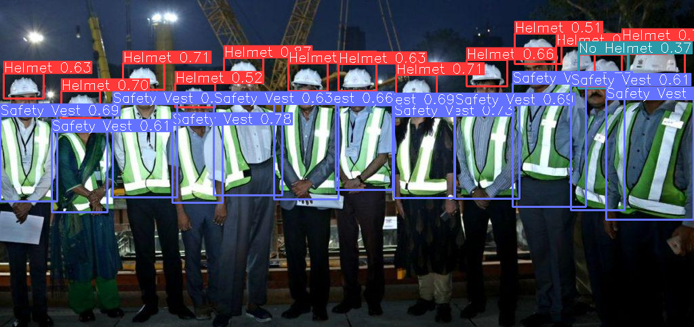

# PPE-KIT DETECTION(SAHI+YOLO)

This AI-powered computer vision model automatically detects whether workers on a construction site are wearing required personal protective equipment (PPE)—specifically safety vests and helmets—in real time.

Designed to enhance workplace safety and simplify compliance monitoring, the model processes live video feeds or image uploads from site cameras to identify safety violations instantly.

## Key Highlights
* Dual PPE Detection: Simultaneously scans for two essential safety items—high-visibility safety vests and hard hats/helmets.

* Real-Time Visual Bounding Boxes: Draws color-coded boxes around workers, highlighting compliance (e.g., green for full PPE) and non-compliance (e.g., red for missing gear).

* Multi-Person Scanning: Accurately tracks multiple workers across crowded, dynamic construction environments, even under complex lighting or partial occlusions.

* Instant Automated Alerts: Triggers immediate notifications or logs incident timestamps whenever non-compliant personnel enter active work zones.

* Safety & Compliance Analytics: Generates daily or weekly safety compliance scores to help site managers target safety training and reduce workplace injuries.

## Tech Stack

Python,JupyterNotebook,Opencv-Yolov11n

## Authors

- [@toRK25](https://github.com/toRK25)

## Result

## I won't give you my fine tuned `best.pt` do it yourself!! It took me 15 days, so do some hard work, noob.

